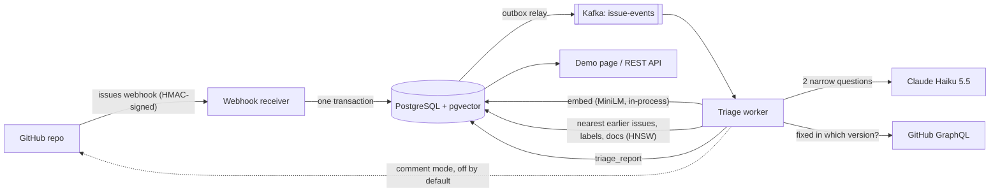

# issue-triage-assistant

A maintainer-side GitHub issue triage assistant. When an issue is opened, it **privately** tells the maintainer within seconds:
likely duplicates (with a score and a second check by an LLM), suggested labels, which details the reporter left out, whether a
similar issue was already fixed in a later version, and a draft reply grounded in the project's docs. Java 21, Spring Boot 4,
Kafka, PostgreSQL + pgvector, Claude Haiku 5.5, k3s.

## The problem

Maintainers of big open-source projects spend a large part of their time on triage: is this a duplicate, which version is it,
is there a stack trace, is it already fixed, which doc page answers it? Spring Boot alone has over 43,000 issues. Search on
GitHub is keyword-based, and new reporters describe the same bug in different words.

## How it works



1. **Intake**: `POST /webhooks/github` checks the HMAC signature, then writes the delivery id and the event to an **outbox**
   table in one Postgres transaction and answers GitHub at once. A relay sends outbox rows to Kafka in order (at least once).
2. **Worker** (Kafka consumer, idempotent): stores the issue, embeds it (all-MiniLM-L6-v2, in-process), and on `opened`
   builds the report:
   - **duplicates**: the 3 nearest *earlier* issues of the repo (pgvector HNSW, cosine);
   - **LLM check** of the top match ("same root problem?", strict JSON) when it scores ≥ 90%;
   - **labels**: a similarity-weighted vote of the 10 nearest issues;
   - **missing details**: version / steps / expected vs actual / logs (LLM, strict JSON, one retry, else "unknown");
   - **already fixed?**: the match's closing PR/commit and milestone vs the reporter's Spring Boot version (no LLM);
   - **draft reply** (RAG): the nearest reference-doc sections (v4.1.2) and similar issues → a short reply that may link
     only to those sources; no relevant source → no draft.
3. **Cost guard**: a daily token budget; above it, LLM parts say "paused" and the rest of the report still works.
4. **Comment mode** (opt-in per repo, at most one comment per issue): only for open issues from outside the team, never on
   bookkeeping clones, and only when the match is ≥ 90% *and* the LLM agrees.

## Results

Time-ordered replay on **spring-projects/spring-boot** (43,810 issues). Each maintainer-confirmed duplicate is searched as if
it had just been opened, against **earlier issues of the same repo only**. The answer key comes from GitHub's own records;
**833** pairs are scored ([docs/m3-results.md](docs/m3-results.md), [docs/m3-report.md](docs/m3-report.md)).

| Method | recall@1 | recall@3 | recall@10 | MRR |
|---|---|---|---|---|
| Keyword baseline (Postgres full-text, `ts_rank`) | 19.2% | 26.5% | 37.1% | 0.244 |
| **Vector** (all-MiniLM-L6-v2 + pgvector HNSW) | **31.0%** | **46.2%** | **60.9%** | **0.403** |

**Public comments are the hard part** (external reporters; 720 duplicates, 1,000 non-duplicates;
[docs/m4-results.md](docs/m4-results.md)):

| Rule | Correct flags (of 720) | False alarms (of 1,000) |
|---|---|---|
| Score ≥ 0.825 | 55 | 101 (10.1%) |
| Score ≥ 0.825 + Claude "same problem" | 50 | 48 (4.8%) |
| Score ≥ 0.90 + Claude "same problem" | 19 | 25 (2.5%) |

The LLM check halves the false alarms. But only ~4% of new external issues are duplicates, so even then most public comments
would point at the wrong issue (many of the rest are the team's own forward-port clones, which comment mode now skips). That is
why the default is **shadow mode**: a private top 3 for the maintainer.

- **Labels:** suggested for 30.6% of recent external issues; the top label is right 69.3% of the time.
- **Cost:** a full report is ~1,000–5,800 tokens on Claude Haiku 5.5 (≈ $0.0002–0.001).
- **Hand-scoring:** 30 recent issues with full reports in [docs/m4-scoring.md](docs/m4-scoring.md) (and two draft versions
  side by side, blind, in [docs/m4-scoring-v3.md](docs/m4-scoring-v3.md)).

## Run locally

```bash
colima start              # the Docker runtime used here (any Docker works)
docker-compose up -d      # Postgres + pgvector on localhost:5433 (database "triage"), Kafka on localhost:9092
./mvnw spring-boot:run    # Flyway creates/updates the schema; open http://localhost:8080/ for the demo page
```

Postgres is on host port **5433**, so it doesn't clash with a locally installed Postgres. Secrets only ever come from env vars:
`GITHUB_TOKEN` (backfill), `GITHUB_WEBHOOK_SECRET` (webhooks), `ANTHROPIC_API_KEY` (without it, a rule-based stand-in LLM is
used and the page says so).

```bash
curl -X POST localhost:8080/backfill/spring-projects/spring-boot              # load issues (~12 min)
curl -X POST localhost:8080/backfill/spring-projects/spring-boot/duplicates   # answer key (~19 min)
curl -X POST localhost:8080/embeddings/spring-projects/spring-boot            # embeddings (~6 min)
curl -X POST localhost:8080/docs/spring-projects/spring-boot                  # reference docs for drafts (~15 s)
curl -X POST localhost:8080/reports/spring-projects/spring-boot/52529         # one triage report
curl -X POST localhost:8080/eval/spring-projects/spring-boot                  # the replay (~3 min)
./mvnw test                                                                   # 245 tests; Testcontainers for Postgres and Kafka
```

Container image and deployment: `./mvnw spring-boot:build-image` (linux/arm64, buildpacks) and `deploy/k3s/`
(Postgres and Kafka StatefulSets, the app with startup/liveness/readiness probes, an Ingress, and a secret *template*).

## Design decisions

- **PostgreSQL + pgvector, not Cassandra or MongoDB.** The data is relational (issues, labels, reports, deliveries) and small
  (tens of thousands of rows per repo). One database gives transactions across the issue, its embedding and the outbox, plus
  full-text search for the keyword baseline and HNSW for vectors. Cassandra shines at huge write volumes with simple key
  access, which this isn't; a separate vector store would add a system to keep in sync.
- **Kafka between intake and work.** GitHub waits at most 10 s for a webhook answer; embedding and LLM calls take seconds and
  can fail. Kafka decouples them, keeps per-issue order (key = issue), gives retries and a dead-letter topic, and lets the
  worker scale separately.
- **Transactional outbox.** "Write to Postgres" and "write to Kafka" can't be one atomic step. The webhook writes the event to
  an outbox table in the same transaction; a relay publishes it. Events are never lost, and webhooks are accepted while Kafka
  is down.
- **Shadow mode first.** Measured: at a 4% duplicate base rate, automatic public comments are mostly wrong even with an LLM
  check. So the default is a private report; public comments are opt-in, strict, and never repeated.
- **Our own interfaces around the AI.** `EmbeddingService` and `TriageLlm` are ours; tests use a fake LLM; prompts are
  versioned files; LLM output is parsed as strict JSON with one retry, else "unknown"; every report stores the model,
  prompt versions and tokens.
- **Measure before trusting.** Every threshold came from the replay (false alarms on non-duplicates, not just recall on
  duplicates), and ideas that didn't help (excluding forward-port clones from the candidates: recall went down) were dropped.

## Limits

- The duplicate check and the false-alarm numbers rely on what maintainers *marked*; some "false alarms" are real but unmarked
  duplicates.
- The "already fixed?" version parsing is Spring Boot-specific; the reference docs are one version (4.1.2).
- One replica of each component on one small VM: no high availability.
- MiniLM reads only ~256 word pieces per text; long issues are judged by their start.
